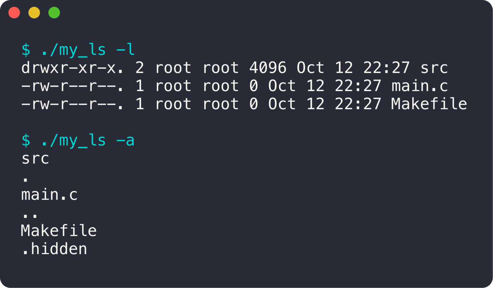

<div align="center">

# my_ls

**La commande ls, recodée avec les appels système.**

  

<sub>Projet solo · 2022</sub>

</div>

<br/>

<p align="center"></p>

## En deux mots

Une version de `ls` écrite avec `opendir`, `readdir` et `stat`.

## Ce que ça fait

- Listing du dossier courant ou d'un chemin
- `-a` : fichiers cachés
- `-l` : permissions, liens, propriétaire, groupe, taille, date

## Sous le capot

On lit le dossier avec `readdir`, puis pour le format long on appelle `stat` sur chaque entrée, et `getpwuid` / `getgrgid` pour le propriétaire et le groupe.

## Lancer le projet

```bash
make
./my_ls -l
```
